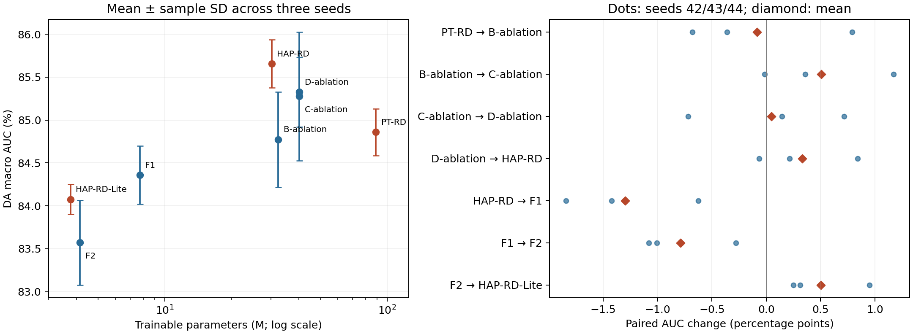

# DA publication：三种子完整消融链汇总

24 个实验（8 种配置 × seed42/43/44）已完成，包含 168 个独立场景模型的结果。本轮从头训练 17 个实验、119 个场景任务，复制复用 7 个实验、49 个场景结果；调度器记录无失败。训练于北京时间 2026-11-19 01:35:50 全部结束。

**主要观察：HAP-RD 的三种子平均 AUC 最高；PODP 在 F2 上带来三个种子一致的 AUC 提升，同时进一步减少参数。LAGA 在标准 Transformer 模板上的 AUC 增益很小且 EER 升高，本轮证据不支持把整条链写成每步都稳定提升。**

## 统计与评分口径

- 每个场景拼接全部测试视频，计算 AUC×100 和离散 ROC EER；先对七场景等权宏平均，再对三个种子求均值及样本标准差（ddof=1）。不是把全部场景帧混在一起计算一项 AUC。
- AUC 单位为百分数，差值为百分点；EER 保留 0–1 比例，越低越好。EER 取 `fpr[argmin(abs(1-tpr-fpr))]`，不作插值。
- 所有模型采用逐 patch cosine distance 的 Top-5。四 tap 模型取四层均值；十二 tap 模型按四组三层计算 `(1−α)mean+α max` 再平均。训练取同一 match 的 batch mean，测试使用逐帧 match 分数，无分数翻转、重新归一化或择优读出。
- 统一 DA、冻结 DINOv3 ViT-B/16、256×256 输入（256 patches）、30 epoch、batch64、AdamW + OneCycleLR、max_lr=5e-4、weight_decay=0.05、code_dim64、tap_norm=True。
- 参数量仅计学生解码器和瓶颈的可训练参数，冻结教师不计入。

## 总体矩阵

| 配置 | 参数 M | seed42 AUC | seed43 AUC | seed44 AUC | AUC 均值 ± SD | EER 均值 ± SD |
|---|---:|---:|---:|---:|---:|---:|
| PT-RD | 89.079 | 84.7916 | 84.6246 | 85.1584 | 84.8582 ± 0.2730 | 0.200161 ± 0.003809 |
| B-ablation | 32.376 | 84.4289 | 85.4137 | 84.4774 | 84.7733 ± 0.5551 | 0.198491 ± 0.001776 |
| C-ablation | 40.259 | 84.4148 | 85.7704 | 85.6476 | 85.2776 ± 0.7497 | 0.191865 ± 0.006638 |
| D-ablation | 40.259 | 85.1314 | 85.0532 | 85.7929 | 85.3258 ± 0.4064 | 0.197044 ± 0.005342 |
| HAP-RD | 30.248 | 85.3461 | 85.8928 | 85.7268 | 85.6552 ± 0.2803 | 0.192889 ± 0.001900 |
| F1 | 7.718 | 84.7227 | 84.0514 | 84.3026 | 84.3589 ± 0.3392 | 0.197197 ± 0.002575 |
| F2 | 4.154 | 83.6434 | 83.0453 | 84.0253 | 83.5713 ± 0.4940 | 0.201945 ± 0.005635 |
| HAP-RD-Lite（shared-Q historical） | 3.761 | 83.9554 | 83.9961 | 84.2750 | 84.0755 ± 0.1740 | 0.199574 ± 0.001591 |

完整精度及各 seed EER 见 [matrix.csv](results/matrix.csv)；168 项逐场景结果见 [scene_metrics.csv](results/scene_metrics.csv)。

## 相邻步骤的种子配对差值

差值均为“后者 − 前者”；AUC 正值更好，EER 负值更好。同 seed 仅用于配对索引，不表示不同结构具有相同初始化张量。

| 步骤 | seed42 ΔAUC | seed43 ΔAUC | seed44 ΔAUC | 平均 ΔAUC ± SD | AUC 提升种子数 | 平均 ΔEER | 参数减少 |
|---|---:|---:|---:|---:|---:|---:|---:|
| PT-RD → B-ablation | -0.3627 | +0.7891 | -0.6810 | -0.0848 ± 0.7734 | 1/3 | -0.001670 | +63.65% |
| B-ablation → C-ablation | -0.0141 | +0.3567 | +1.1702 | +0.5043 ± 0.6058 | 2/3 | -0.006626 | -24.35% |
| C-ablation → D-ablation | +0.7165 | -0.7172 | +0.1453 | +0.0482 ± 0.7218 | 2/3 | +0.005179 | +0.00% |
| D-ablation → HAP-RD | +0.2147 | +0.8396 | -0.0662 | +0.3294 ± 0.4637 | 2/3 | -0.004156 | +24.87% |
| HAP-RD → F1 | -0.6234 | -1.8415 | -1.4242 | -1.2964 ± 0.6190 | 0/3 | +0.004308 | +74.48% |
| F1 → F2 | -1.0793 | -1.0061 | -0.2773 | -0.7876 ± 0.4434 | 0/3 | +0.004748 | +46.17% |
| F2 → HAP-RD-Lite | +0.3121 | +0.9508 | +0.2497 | +0.5042 ± 0.3880 | 3/3 | -0.002371 | +9.46% |

“参数减少”为负表示该步骤参数增加。可复核数据见 [paired_contrasts.csv](results/paired_contrasts.csv)。

## 按场景分析

下表为每场景三个种子的 AUC 均值；逐场景 SD、EER、配对差值保存在 [summary.json](summary.json)。

| 场景 | PT-RD | B | C | D | HAP-RD | F1 | F2 | Lite |
|---|---:|---:|---:|---:|---:|---:|---:|---:|
| Bike Roundabout | 98.056 | 98.108 | 97.719 | 97.742 | 97.706 | 97.835 | 97.794 | 97.784 |
| Crossroads | 60.731 | 61.220 | 60.194 | 60.066 | 59.754 | 58.380 | 57.936 | 58.324 |
| Farmland Inspection | 99.379 | 99.405 | 99.322 | 99.510 | 99.422 | 99.551 | 99.534 | 99.565 |
| Highway | 93.240 | 92.930 | 95.783 | 94.894 | 94.102 | 94.515 | 94.153 | 94.413 |
| Railway Inspection | 96.914 | 96.585 | 94.164 | 95.169 | 95.626 | 92.253 | 91.190 | 91.663 |
| Solar Panel Inspection | 86.034 | 86.967 | 89.139 | 89.443 | 89.567 | 87.061 | 86.214 | 86.614 |
| Vehicle Roundabout | 59.652 | 58.199 | 60.622 | 60.456 | 63.409 | 60.916 | 58.178 | 60.166 |

Bike 与 Farmland 在所有配置下已接近高 AUC 区间，压缩的影响主要体现在 Railway、Solar、Vehicle 和 Crossroads。HAP-RD 相对 PT-RD 在 Solar、Vehicle 分别提高 3.533、3.757 个百分点，但 Crossroads、Railway 分别降低 0.977、1.288 个百分点；宏平均提升并不代表每个场景都改善。

Lite 相对 HAP-RD 的主要退化来自 Railway（−3.963）、Vehicle（−3.243）和 Solar（−2.953），Bike、Farmland、Highway 则略有提高。F2→Lite 的最大恢复来自 Vehicle（+1.988），其余 Railway、Solar、Crossroads 分别恢复 0.473、0.400、0.388 个百分点；七场景中六个平均 AUC 提升，Bike 略降 0.010 个百分点。

## 逐步消融解释

### PT-RD → B：删除未直接蒸馏的学生 block

保持四个 teacher taps `[5,7,9,11]`、四个重建头、768 宽度和 hidden512，只将 12 个标准 Transformer blocks 减为 4 个，并从头训练。AUC 均值由 84.8582 变为 84.7733（−0.0848），三个种子的差值一正两负，EER 均值由 0.200161 降到 0.198491。参数量从 89.079M 降为 32.376M。结果支持删去这些 block 可以显著压缩模型且观测到的平均 AUC 损失较小；三个种子不足以证明统计等效或这些 block 在任何情况下都无用。

### B → C：扩展深度覆盖与一对三监督

扩为 12 个 teacher taps 和 12 个独立重建头，四个学生 stage 各有三个头分别预测三层教师；α=0 等价于十二层直接平均。平均 AUC 增加 0.5043，EER 降低 0.006626，两个种子提升，seed42 略降 0.0141。Highway、Vehicle、Solar 分别提高 2.853、2.423、2.172，Railway 和 Crossroads 则降低 2.421、1.025 个百分点。该步骤同时扩展瓶颈输入（3072→9216）和头数，参数增至 40.259M；应描述为更完整的深度覆盖与分组配对设计，不能把全部增益归于“只增加重建头”。

### C → D：引入 LAGA，α=0 → 0.5

结构与参数量不变，只在训练损失和匹配测试评分中引入组内 max 项。平均 AUC 仅增加 0.0482，配对差值 SD 为 0.7218；三个种子的变化分别为 +0.7165、−0.7172、+0.1453。EER 均值反而由 0.191865 升至 0.197044。C 的 EER 均值是本轮八种配置中最低的。**本轮不能宣称 LAGA 在标准 Transformer 模板上稳定改善检测。** 它在 Railway、Solar 上的收益被 Highway 等场景的退化抵消；若引用先前 GLLL 模板的 Loss 消融，必须明确模板不同，不能替代本轮 C/D 证据。

### D → HAP-RD：引入 LLLG + gated decoder

将 GGGG + GELU MLP 换为 LLLG + gated FFN。平均 AUC 增加 0.3294，EER 降低 0.004156；三个种子两升一降，seed44 降低 0.0662。Vehicle 提高 2.953 个百分点，但 Highway 降低 0.792。参数从 40.259M 减至 30.248M。该步支持整套 LGGD 在本轮平均效果与参数规模上的优势，但同时改变 mixer 和 FFN，不能据此单独归因于 local mixing、LLLG 顺序或 gate；这些因素应引用已有 GL 矩阵。

### HAP-RD → F1 → F2：分两步定位压缩代价

先将学生宽度 768→192，参数降至 7.718M，平均 AUC 损失 1.2964；再将 PDFB hidden512→128，参数降至 4.154M，平均 AUC 再损失 0.7876。两步各自均在三个种子上降低 AUC，EER 也分别增加 0.004308、0.004748。宽度压缩的损失更大，但两种压缩都产生可观察代价；F1→F2 的七个场景平均 AUC 均降低，其中 Vehicle 降低 2.738 个百分点最明显。

### F2 → HAP-RD-Lite（历史 shared-Q 结果）：加入 PODP

保持 width192、hidden128、LLLG、12 个独立头和 PLDD，加入四组共享的可学习 2×3 Q，随机正交初始化并在前向保持行正交。平均 AUC 增加 0.5042，三个种子分别提高 0.3121、0.9508、0.2497；EER 均值降低 0.002371，AUC 样本 SD 从 0.4940 降至 0.1740。这为 PODP 在该轻量配置上的收益提供了方向一致的三种子证据。Q 只有 6 个可学习系数，但把瓶颈输入从 12×768 压为 8×768，净参数量进一步减少 393,210，降至 3.761M。该比较体现整套 PODP 的作用，不能分开证明收益来自可学习性、正交约束或降秩中的哪一项。这里的数值严格属于旧的 shared-Q 口径，当前四组独立 `Q_g` 的 DA 结果见 [Q定义迁移说明](../../../docs/HAP_RD_LITE_Q_DEFINITION.md)。

## 正式模型的效果与规模取舍

- PT-RD → HAP-RD：参数减少 66.04%，平均 AUC 变化 +0.7971 个百分点，EER 变化 -0.007273。
- PT-RD → HAP-RD-Lite：参数减少 95.78%，平均 AUC 变化 -0.7827 个百分点，EER 变化 -0.000587。
- HAP-RD → HAP-RD-Lite：参数减少 87.57%，平均 AUC 变化 -1.5797 个百分点，EER 变化 +0.006686。

HAP-RD 相对 PT-RD 的三个种子 AUC 均提高，是本轮完整方法的主要正向证据。Lite 相对 PT-RD 的三个种子 AUC 均降低，平均少 0.7827 个百分点；应明确其是大幅减少可训练参数后的效果取舍。Lite 的 EER 均值略低于 PT-RD，但差距仅 0.000587，不能表述成检测性能全面超过参考模型。参数减少也不等于推理延迟或显存按同比例减少，本轮没有测量端到端速度与 FLOPs。

图的左侧是三种子均值及样本 SD，右侧是同 seed 的 AUC 差值与其均值；误差条不是置信区间。[可编辑 SVG](results/publication_tradeoffs.svg)。

## 完整性、复用及限制

- [核验报告](results/validation.json)：168 份逐帧 CSV 的 AUC/EER 全部重算，逐视频、逐帧顺序及标签与数据集核对；168 份最终权重校验 SHA-256 并在 CPU 严格加载到目标模型。
- 119 个新场景的配置、模型 guard、训练日志、checkpoint、source_commit 和运行前代码哈希一致；各有完整 1–30 epoch 日志。所有代码与配置保持运行前哈希。复用部分保留原始指标、评分及 provenance，没有以本次提交冒充原训练源码。
- PT-RD seed42 复用旧 V0；D 三种子复用 GGGG+GELU / V1 等价结果；HAP-RD 三种子复用 GL 的 LLLG+gate 结果。复用的 49 份 JSON/CSV 与原目录逐字节相同；运行前已核验新旧模型前向等价，详见 [preflight](publication_preflight.json)。
- 本轮新训练固定源码为 `aa0f057d834efc9ec30ba1a120b93d9d42aa7028`。模型入口为 `model/publication_rd.py`，新训练入口为 `scripts/da_publication_scene.py`；复用实验的原训练提交以各自 record/provenance 为准。
- 三个种子只支持描述性比较，不作显著性或统计等效断言；七个不同场景不等于同一条件下的七次重复实验。本轮只覆盖 DA，不能外推 UIT。
- B/C/D/F1/F2 保留为[过程结构版本](ARCHITECTURE_VERSIONS.md)，不新增正式模型名，不覆盖旧 V0–V5；F1/F2 为 LLLG，不能直接当作旧 GLLL 的 V3/V4。
- 复现汇总：`/home/lyx/miniconda3/envs/DMAD/bin/python scripts/summarize_da_publication.py`。该脚本只读取已保存分数、CPU 核验权重并重建报告，不启动训练或 GPU 推理。
- Git 保存代码、小型结果、日志、报告和产物索引；权重留在本地并由 Git 忽略，本次 Git 同步不构成权重云端备份。
