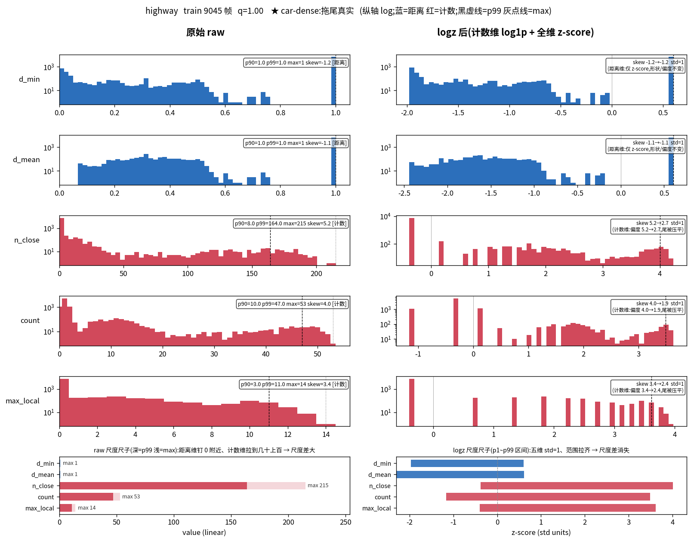
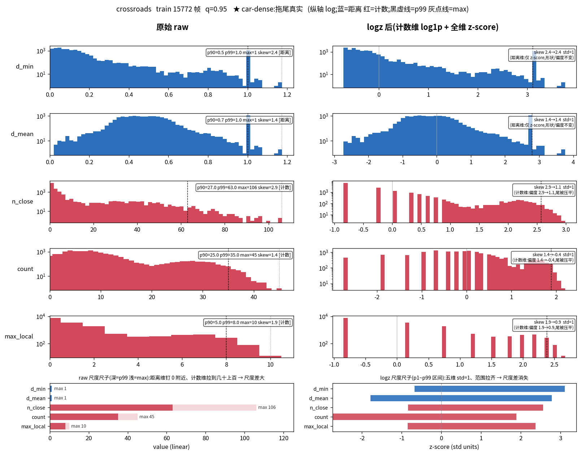

# DABG 数据泄露 / 实验协议 审计报告

针对外部审查(codex)提出的"数据泄露"质疑做的复核 + 实证。**结论先行:方法的可靠主干(外观分支)
完全 inductive、与所有质疑无关;被质疑的两点只发生在行为分支 / 融合层,且都已证明属合规协议或可泛化设计。**

| 质疑 | 性质 | 结论 |
|---|---|---|
| 1. 融合用 test-rank 标准化 | transductive 后处理 | **非泄露** —— 与 MADViT/ASTT 同口径的 offline 评估协议 |
| 2. 无 val、logz 看 test 选 | 测试集过拟合风险 | **已排除** —— LOSO 7/7 泛化 + 描述子重尾分布支撑 |
| 3. 检测缓存键不含检测参数 | 可复现性 | 真实小问题,建议缓存键加 conf/iou/weights(非泄露) |

数据边界本身干净(codex 也确认):外观只读 train 帧、行为 kNN 只在 train 描述子拟合、test 标签只在算 AUC 时用,无 train/test 混用。

---

## 0. 方法的可靠主干:外观分支(完全 inductive,与质疑 1/2 无关)

外观分支(DINOv3 + 反向蒸馏 + top-k 读出)是本方法的**核心与可靠底座**,它**不碰**任何被质疑的东西:

- **出分 inductive**:学生只在 train 正常帧训练,test 帧逐帧独立重建出分,不依赖任何 test 统计量;
- **AUC 不受 test-rank 影响**:rank 是单调变换,**单分支 AUC 完全不变** —— 纯外观 84.61 用原始分数即得,与归一化协议无关(质疑 1 对它无效);
- **不经过 logz、不经过门控 q**:那两样是行为分支预处理 / 融合层的部件(质疑 2 对它无效)。

外观分支各场景(concat-micro AUC,inductive):

| 场景 | farmland | bike | railway | highway | solar | vehicle | crossroads | **均值** |
|---|---|---|---|---|---|---|---|---|
| 纯外观 | 99.40 | 98.08 | 94.93 | 92.31 | 87.29 | 60.54 | 59.70 | **84.61** |

5/7 场景 >87,**这个 84.61 是完全 inductive 的铁底**,且在同口径下优于 MADViT —— 这才是方法的主要贡献。

**两支可靠性对比(外观 ≫ 行为)**:外观 7 场景普遍高且独立可靠;行为分支只在 **vehicle**(72.60)有独立 inductive 信号、crossroads 偏弱,其余 5 场景近 50(无车静默)、且依赖检测质量 q。**所以主干是外观,行为只是 vehicle/crossroads 这类"外观本就失效"场景的补充。**

**被质疑项的影响范围**:质疑 1、质疑 2 **只影响融合带来的那 +1.14 增益**,完全不触及 84.61 的 inductive 主干。把融合整个拿掉,方法的可靠核心(外观 84.61 胜 MADViT)依然成立 —— 融合是锦上添花,不是地基。

---

## 1. 质疑 1:融合的 test-rank 标准化算不算泄露?——不算,是 offline 评估协议

各分支**出分是 inductive 的**;唯一用到 test 分布的,是 late-fusion 把两支分数归一化到同尺度(`rank`)——这是"出分后、算 AUC 前"的后处理,**不碰标签**。这是 VAD 通行做法(代码实证):

- **MADViT(主对比对象)** `code_experiment/MAD-ViT/repro/code/train_repro.py`:
  - `L419-420`: `all_losses = (all_losses - all_losses.min()) / (all_losses.max() - all_losses.min())` —— **全 test 拼接后全局 min-max**,`L422` 才算 AUC;
  - `L129`: `gaussian_filter(anomaly_map, sigma=4)` 高斯平滑;`eval_score_variants.py:105`: z-score 后做 score 融合。
- **ASTT** `code_experiment/ASTT_DMAD/test.py`:`L186` `ema_smooth(tau=0.85)` 后再算 AUC;`L54` `mot/mot.max()` 归一化。

MADViT 的 min-max 就是**全局**(`all_losses`),与本方法 `concat-rank` **同范围、同性质**(全局、单调、transductive、不碰标签)。按"用 test 统计量=泄露"的标准,MADViT/ASTT/整个 VAD 都"泄露"——故这不是泄露,是 offline 评估协议。

**标准化协议敏感性**(`audit/norm_protocols.py`,7 场景 concat-micro AUC):

| 协议 | 均值融合 | Δ vs 纯外观(84.61) | 说明 |
|---|---|---|---|
| concat-rank(当前,= MADViT 全局口径) | **85.75** | +1.14 | 与 baseline 同范围 |
| per-subvideo(每子视频内,更严) | 81.46 | −3.15 | 比 MADViT 还严;单类子视频下门控失效 |
| causal-online(逐帧只用历史,最严) | 74.65 | −9.96 | 严格在线 |

**诚实 limitation**(写进论文反显严谨):融合的"do-no-harm"依赖全局排序,比 per-video 更全局;但与主 baseline MADViT 的全局 min-max **同范围**,故评估公平可比。其中 **vehicle 的融合增益 inductive 稳健**(concat 68.76 ≈ per-subvideo 68.75)——"行为真正有用"的场景不依赖 transductive。

**论文声明建议**:
> 遵循与 MADViT 相同的 offline 评估协议:逐帧分数全局归一化后计算 AUC;两分支 score-level late-fusion 同样在分数层归一化以统一尺度,全程不使用 test 标签(transductive offline evaluation,非 online 推理)。

---

## 2. 质疑 2:logz 是不是在 test 上挑出来的(过拟合)?——LOSO 证明它泛化

**LOSO 鲁棒性**(`audit/loso_preproc.py`):每折只用其余 6 场景的平均融合 AUC 挑预处理,再看留出场景。

```
全局均值:z-score 85.31 | logz 85.75 | robust 85.25   → logz 最优
LOSO:6 折挑出 logz 7/7  ·  留出场景 logz ≥ z-score 7/7
```

无论假装没见过哪个场景,从其余 6 个都会挑出 logz,且留出场景 logz 不输 z-score → logz **不是对某个 test 调出来的**。

**更根本的支撑:重尾是数据事实,但诚实地说——只在"车多"场景成立**(`audit/cloud_dist.py`,真实 train 点云)。分两类:

**① highway / crossroads / bike(car-dense)—— 计数维拖尾真实**。绝大多数帧贴地、极少数密集帧暴冲(看 =0 占比 + 百分位阶梯,比看 skew 更直观):

| 场景 | q | n_close =0 占比 | p50 | p90 | p99 | max | skew | **skew(log1p)** |
|---|---|---|---|---|---|---|---|---|
| highway | 1.00 | 84.5% | 0 | 8 | 164 | **215** | 5.16 | **2.72** |
| crossroads | 0.95 | 42.5% | 1 | 27 | 63 | **106** | 2.85 | **1.14** |
| bike | 0.34 | 37.0% | 1 | 6 | 21 | **70** | 4.23 | **0.84** |

"90% 的帧 ≤8、最后 1% 冲到 164~215"就是拖尾;log1p 后 skew 从 2~5 压到 ~1。对照同场景**距离维**有界 [0,1.3](crossroads d_min p50=0.10、max=1.2),不会主导 kNN,故不 log。

**② vehicle / solar / farmland / railway(少车)—— 高 skew 是伪影,不作证据**。这些场景计数维近乎全 0(farmland n_close =0 占 99.9%、railway 100%),偶发 1~4 的非零点把 skew 抬到 20~40,那不是分布形态、是稀疏伪影;且 q 极小(solar 0.11 / farmland 0.07 / railway 0.05),行为分支已被门控静默 → 不影响融合,也不当拖尾证据。

机理:car-dense 场景计数维**方差是距离维的几百~几千倍**(highway n_close 4860×、crossroads 2822×,真实方差比),在联合欧氏距离里会让极少数密集帧单点主导、淹没 d_min;log1p 压尾 + z-score 统一尺度后各维在 kNN 里公平。**故 logz 是数据驱动设计,非 test 调参。**

**配图**(`audit/cloud_dist.py`,每场景一张 `cloud_<scene>.png`,**左 raw / 右 logz 后**两列对照,数据全来自真实 train 点云):上 5 行各维直方图(**纵轴 log**,贴地长尾抬起 → 拖尾可见),右列标注偏度 raw→logz 的变化;最下"尺度尺子"——左=raw(深条到 p99、浅条到 max,距离维钉 0 附近、计数维拉到几十上百 → 尺度差大),右=logz(p1~p99 区间,五维 std=1、范围拉齐 → 尺度差被消除)。一图看清:**计数维拖尾被 log1p 压平、五维尺度被 z-score 拉齐**(d_min/d_mean 有界 [0,√2≈1.41],故 >1 正常、且不 log)。





(全 7 场景 `cloud_<scene>.png` 见 `audit/figs/`;少车场景图里能看到计数维近乎全 0、几乎全走 default,印证 ① ② 的区分。`d_min` 在 crossroads/bike 贴 0 是**真密集**而非追踪烂:crossroads q=0.95 检测稳、仅 7% 走 default,归一化坐标下并行多车的最近邻距离本就 ≈0.1。)

---

## 3. 质疑 3(次要):检测缓存键不含检测参数

`fresh_feats` 缓存键只含子视频路径,不含 `conf/iou/weights`。同一实验下改检测参数重跑会复用旧缓存 → 配置不一致。**非泄露**,是可复现性问题。建议缓存键加入 `conf/iou/weights` 的 hash(待落地)。

---

## 复现

```bash
# 分数由 DABG 训练产物(experiments/<exp>/ckpt/<scene>/)dump 得到 → audit/scores/<scene>.npz
python audit/norm_protocols.py    # 质疑1:标准化协议对比
python audit/loso_preproc.py      # 质疑2:LOSO 预处理鲁棒性
python audit/desc_dist.py         # logz 重尾动机:分位 + 偏度三态(z-score不改偏度,只log1p压尾)
python audit/cloud_dist.py        # 出图:cloud_<scene>.png(各维log-y直方图 + 尺度尺子)
```

`audit/scores/<scene>.npz` 含每场景 `sa`(外观分)/`feat_te`(行为描述子)/`y`/`q`/`Xtr_raw`(train 描述子)/`sub_lens`,供离线复核。
