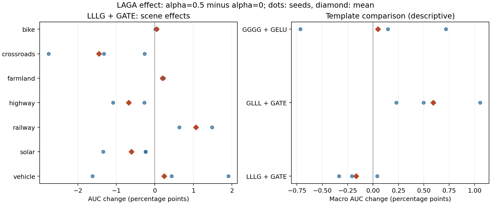

# DA / LGGD：LAGA 三种子补充消融

**本轮没有复现“加入 LAGA 一致提升”的现象。** 在 LLLG+GATE 下，α=0 的平均 AUC 为 85.8234%，高于 α=0.5 的 85.6552%；不带 LAGA 的平均 EER 也更低。加入 LAGA 后，AUC 三个种子一升两降，EER 三个种子均升高。

## 设置与证据

新增配置为 **HAP-RD w/o LAGA**（别名 d-new-ablation / LGGD without LAGA）。LLLG+gate ratio2、学生宽度768、PDFB hidden512、code_dim64、12 taps/12个独立头、无PODP，可训练参数30,248,000。与同seed的正式HAP-RD比较，仅将训练及match测试的α从0.5改为0。四组三层等权mean在α=0时等价于12层平均，Top-5 patch cosine计算不变。

新增seed42/43/44、每seed七场景，共21个新训练任务，全部30 epoch完成、无失败。15:12:29启动、21:56:41结束（北京时间2026-11-19）。冻结DINOv3 ViT-B/16、256×256输入、batch64、AdamW+OneCycleLR、max_lr=5e-4、weight_decay=0.05等固定设置与基线一致。基线复用已完成的GL LLLG+gate结果，未重新训练或改写。

分数越大越异常。场景内拼接全部测试视频后计算AUC×100及离散ROC EER，再对七场景等权宏平均，最后对三seed求均值和样本SD（ddof=1）。EER为0–1比例，越低越好；取`fpr[argmin(abs(1-tpr-fpr))]`，不插值。

## 种子矩阵

| seed | α=0 AUC | α=0.5 AUC | 加入LAGA ΔAUC | α=0 EER | α=0.5 EER | 加入LAGA ΔEER |
|---|---:|---:|---:|---:|---:|---:|
| 42 | 85.3057 | 85.3461 | +0.0404 | 0.191654 | 0.194522 | +0.002867 |
| 43 | 86.2280 | 85.8928 | -0.3351 | 0.188565 | 0.193341 | +0.004776 |
| 44 | 85.9365 | 85.7268 | -0.2097 | 0.189177 | 0.190803 | +0.001626 |
| 均值 ± SD | 85.8234 ± 0.4714 | 85.6552 ± 0.2803 | -0.1682 ± 0.1912 | 0.189799 ± 0.001636 | 0.192889 ± 0.001900 | +0.003090 ± 0.001587 |

所有差值统一定义为 **α=0.5 − α=0**；AUC正值有利于LAGA，EER负值有利于LAGA。AUC差值单位为百分点。完整精度见 [comparison_matrix.csv](comparison_matrix.csv)。

加入LAGA的平均AUC变化为−0.1682个百分点，平均EER变化为+0.003090。α=0.5的AUC跨seed样本SD较小（0.2803 vs 0.4714），但均值和EER不占优，不能单凭SD较小宣称整体更好。三seed不足以证明显著差异或α=0在总体上必然更好。

## 场景分解

| 场景 | α=0 AUC均值 | α=0.5 AUC均值 | 平均ΔAUC | seed42 Δ | seed43 Δ | seed44 Δ | 平均ΔEER |
|---|---:|---:|---:|---:|---:|---:|---:|
| Bike Roundabout | 97.6635 | 97.7061 | +0.0427 | +0.0134 | +0.0645 | +0.0502 | -0.000729 |
| Crossroads | 61.2033 | 59.7540 | -1.4494 | -1.3245 | -2.7594 | -0.2641 | +0.005340 |
| Farmland Inspection | 99.2163 | 99.4215 | +0.2052 | +0.1864 | +0.2303 | +0.1989 | -0.008814 |
| Highway | 94.7786 | 94.1024 | -0.6763 | -0.2703 | -1.0855 | -0.6730 | +0.017650 |
| Railway Inspection | 94.5609 | 95.6262 | +1.0653 | +1.4832 | +0.6341 | +1.0786 | -0.003276 |
| Solar Panel Inspection | 90.1731 | 89.5671 | -0.6060 | -0.2402 | -1.3401 | -0.2378 | +0.009851 |
| Vehicle Roundabout | 63.1680 | 63.4093 | +0.2414 | +0.4348 | +1.9101 | -1.6207 | +0.001606 |

LAGA在Bike、Farmland、Railway的三个seed中均提高AUC，其中Railway平均提高1.0653个百分点；在Crossroads、Highway、Solar的三个seed中均降低AUC，平均分别下降1.4494、0.6763、0.6060。Vehicle平均提高0.2414，但seed44下降1.6207，表现并不一致。因此平均退化来自场景收益与损失的抵消，并不是LAGA对所有场景都无效。

EER的最大不利变化来自Highway（+0.017650），随后是Solar（+0.009851）和Crossroads（+0.005340）；Farmland、Railway、Bike则改善。保留AUC和EER两项指标，避免只报告有利方向。

## 与先前Loss及C→D结果并列

| 模板 | α=0 AUC均值 | α=0.5 AUC均值 | 平均ΔAUC | AUC提升seed数 | 平均ΔEER |
|---|---:|---:|---:|---:|---:|
| GGGG + GELU | 85.2776 | 85.3258 | +0.0482 | 2/3 | +0.005179 |
| GLLL + GATE | 84.9131 | 85.5068 | +0.5937 | 3/3 | -0.000835 |
| LLLG + GATE | 85.8234 | 85.6552 | -0.1682 | 1/3 | +0.003090 |

GLLL+GATE来自先前Loss矩阵的Top-5/12层平均与Top-5/四组α=0.5；GGGG+GELU来自原publication的C/D。两组引用原已审计汇总，本轮没有重跑，也没有混用GL矩阵里其他seed43/44的V2结果。各来源路径和SHA-256见 [laga_comparison.json](laga_comparison.json)。

**三组证据共同说明：目前不能假定LAGA收益跨decoder模板保持一致。** 先前GLLL模板有正向平均增益，标准GGGG模板增益很小，本次LLLG模板则平均略降。这支持“收益可能依赖模板或其配对误差分布”的解释方向，但不是decoder×LAGA交互的显著性检验，也不足以把差异唯一归因于Global block的位置。历史复用、执行入口和物理GPU分配不同，同seed不是同一张卡上的逐位配对重训。

从模型路由看，LLLG的Global位于最后stage，直接输出teacher0–2的三个头；GLLL的Global位于第一stage，其表示还会被后续Local blocks处理。组内最大误差加权对不同路由可能产生不同的优化偏好；这是机制假设，本轮没有记录每层/每patch误差轨迹，不能据此下因果结论。

## 对论文表述的影响

- 可将本实验作为HAP-RD（LLLG+GATE）下直接移除LAGA的证据，与原C/D并列；应完整报告混合与负向结果，不把原GLLL的正向增益直接移植为LLLG的结论。
- α=0的平均AUC比现有α=0.5正式HAP-RD高0.1682个百分点，且EER在三个seed均更低；它是值得保留的候选配置，但本次只归档结果，不自动改变已确认正式模型的定义。
- 原八配置publication矩阵保持原值；本实验是补充行，不覆盖原D或HAP-RD，也不冒充新的正式变体。
- 训练目标和匹配测试读出随α一起改变。因此这是匹配的整体设计比较，不单独隔离训练损失效应。

图中每个圆点为一个seed，菱形为三seed均值；无显著性或置信区间含义。[SVG](laga_effects.svg)。

## 完整性与复现

[validation.json](validation.json)记录主比较的42份CSV重算AUC/EER、数据集帧顺序/标签核对、42份最终checkpoint的SHA-256和严格模型加载。21个新场景均有完整1–30 epoch日志，config、运行guard、checkpoint、固定source及preflight哈希一致。新训练源码为`c43f0d23360cce0b574eeeb3589ac793e00fb548`；基线保留各自原始训练来源。

旧GL构造器与新ablation构造器在相同RNG状态下的初始参数逐张量相同也经CPU核验；这验证模型构造差异没有引入额外结构/初始化变化，不保证跨硬件训练逐位相同。初次preflight因缺少显式evaluation.workers字段失败的记录仍保留在preflight_attempt1.json；修正后再正式训练，没有训练失败被丢弃。

可复现命令：`/home/lyx/miniconda3/envs/DMAD/bin/python scripts/summarize_da_laga.py`。仅CPU读取已有结果和权重，不训练、不重新推理或改写逐帧分数。权重仍是Git忽略的本地产物。
