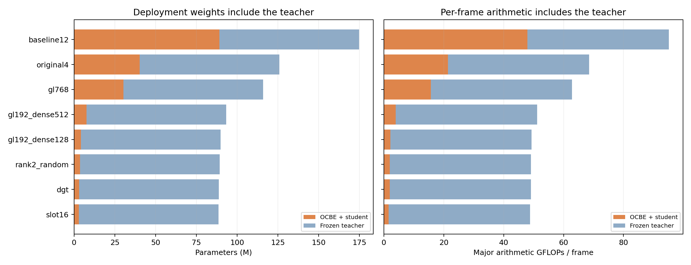
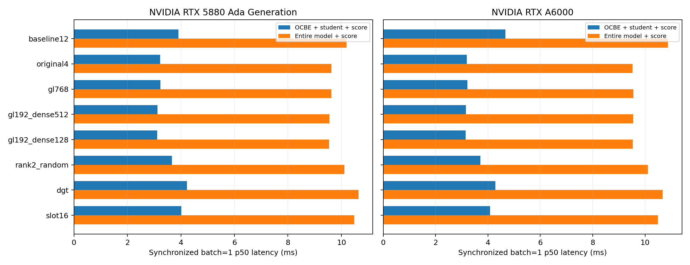

# 从原始学生到DGT：轻量化性能统一审计

本次是现有模型的统一FP32推理重测，未重新训练或选择AUC。完整机器可读数据见summary.csv与gpu0.json/gpu1.json。

## 基线和比较口径

约89M的基线对应12个原始学生block、4个蒸馏tap、Dense512；精确OCBE＋学生参数为89,079,104。原始4block＋12个重建头＋Dense512为40,258,880。原始4block通过减少block数量轻量化，GL再改变block内部结构，两者需要分开列出。

冻结教师为85,641,216个参数，在推理中仍然需要运行。以下core=OCBE＋学生；full=教师＋OCBE＋学生；两条pipeline的Latency/FPS均包含实际top-5异常分数。按用户最新定义，蒸馏外观分支即整个模型；行为分支已取消。

历史基线只重建、评分4个tap；其余架构保留12个重建头并评分12层。这里比较各版本原本的推理流程，不把它们改成相同输出头；因此参数/FLOPs/时延变化同时包含已落地的输出接口变化，不能全部归因于block数目。组件附表另列不含评分的网络前向。

FLOPs口径：1MAC=2FLOPs，仅计GEMM、卷积和attention的QK/AV。LayerNorm、激活、softmax、逐元素Q运算、top-k、偏置和数据搬运不在该FLOPs数值内，实际时延包含这些算子。它不是完整标量指令数。

输入256×256，FP32，TF32/AMP关闭，batch=1/16；每项预热30次，3轮×100次。Latency为每次CUDA同步的墙钟p50，另报告p95；串行FPS=1000×batch/Latency。批量吞吐另用连续队列测量。

部分DGT变体训练代码每次前向包含诊断量转CPU。主表删除这些诊断统计和拷贝，逐版本batch1/16验证输出一致；原始含诊断Latency保留附表。没有做模型剪枝、融合、量化、compile或精度替换。

## 参数、FLOPs和Model Size

大小为实际torch.save纯state_dict的序列化长度，内存中测量；排除优化器和训练metadata，MiB=2^20字节。CSV另给FP32 tensor payload、MB；原始GPU JSON保留字节数。它是部署权重存储量，不等于运行显存。

| 版本 | OCBE参数M | core参数M | full参数M | OCBE GFLOPs | 学生 GFLOPs | core GFLOPs | full GFLOPs | core大小MiB | full大小MiB | 历史AUC |
|---|---:|---:|---:|---:|---:|---:|---:|---:|---:|---:|
| 原始学生12block＋4tap Dense512 | 1.612352 | 89.079104 | 174.720320 | 0.8221 | 47.1356 | 47.9577 | 95.1068 | 339.86 | 666.60 | 84.6657 |
| 原始学生4block＋12head Dense512 | 4.770368 | 40.258880 | 125.900096 | 2.4327 | 18.9499 | 21.3826 | 68.5317 | 153.60 | 480.35 | 83.9505 |
| 原始4block＋channel adapter Dense512 | 4.770368 | 40.708448 | 126.349664 | 2.4327 | 19.1764 | 21.6091 | 68.7581 | 155.32 | 482.07 | 84.1148 |
| 原始4block＋spatial adapter Dense512 | 4.770368 | 40.711328 | 126.352544 | 2.4327 | 19.1777 | 21.6104 | 68.7595 | 155.34 | 482.08 | 83.9376 |
| GL768＋Dense512 | 4.770368 | 30.248000 | 115.889216 | 2.4327 | 13.2227 | 15.6554 | 62.8045 | 115.42 | 442.16 | 84.7735 |
| GL192＋Dense512 | 4.770368 | 7.718336 | 93.359552 | 2.4327 | 1.5504 | 3.9830 | 51.1321 | 29.47 | 356.21 | 82.5381 |
| GL192＋Dense128 | 1.206464 | 4.154432 | 89.795648 | 0.6082 | 1.5504 | 2.1585 | 49.3076 | 15.88 | 342.62 | 82.6137 |
| GL192＋Dense128＋固定Rank2 | 0.813248 | 3.761216 | 89.402432 | 0.4068 | 1.5504 | 1.9572 | 49.1063 | 14.38 | 341.12 | 82.7351 |
| GL192＋Dense128＋共享可学习随机Q | 0.813254 | 3.761222 | 89.402438 | 0.4068 | 1.5504 | 1.9572 | 49.1063 | 14.38 | 341.12 | 82.9599 |
| DGT固定图 | 0.231750 | 3.179718 | 88.820934 | 0.4121 | 1.5504 | 1.9624 | 49.1115 | 12.16 | 338.90 | 82.5063 |
| DGT-NoGraph | 0.231622 | 3.179590 | 88.820806 | 0.4110 | 1.5504 | 1.9614 | 49.1105 | 12.16 | 338.90 | 82.4545 |
| DGT-CrossAttnPool | 0.234214 | 3.182182 | 88.823398 | 0.4290 | 1.5504 | 1.9794 | 49.1284 | 12.17 | 338.91 | 82.2708 |
| DGT-Bilinear | 0.234790 | 3.182758 | 88.823974 | 0.4158 | 1.5504 | 1.9661 | 49.1152 | 12.17 | 338.92 | 81.7885 |
| Slot16 | 0.067622 | 3.015590 | 88.656806 | 0.1007 | 1.5504 | 1.6510 | 48.8001 | 11.53 | 338.28 | 81.9551 |
| ResidualDepth（原loss） | 0.236838 | 3.184806 | 88.826022 | 0.4158 | 1.5504 | 1.9661 | 49.1152 | 12.18 | 338.92 | 82.1869 |
| ResidualDepth（score-aligned） | 0.236838 | 3.184806 | 88.826022 | 0.4158 | 1.5504 | 1.9661 | 49.1152 | 12.18 | 338.92 | 82.1038 |

历史12block基线results.csv仅保留两位小数，宏平均以该文件计算；这不是对话中84.81的复现，也不改写旧实验AUC。当前审计主要比较资源和速度。loss-only的ResidualDepth两版本推理结构相同，应把微小时延差看成测量波动，不能归因于loss降低推理复杂度。

### 模型重建与权重来源

参数结构按config登记的源实验重建，逐个断言精确参数量。下表的初始化模型仅用于结构资源审计，不能把其输出解释为已训练模型的检测能力；历史AUC来自原实验。完整checkpoint SHA256、路径在gpu0.json。

| 版本 | 本次使用权重 | checkpoint SHA256前12位 |
|---|---|---|
| 原始学生12block＋4tap Dense512 | seed42同构初始化（旧权重本机缺失） | — |
| 原始学生4block＋12head Dense512 | seed42同构初始化（旧权重本机缺失） | — |
| 原始4block＋channel adapter Dense512 | seed42同构初始化（旧权重本机缺失） | — |
| 原始4block＋spatial adapter Dense512 | seed42同构初始化（旧权重本机缺失） | — |
| GL768＋Dense512 | seed42同构初始化（旧权重本机缺失） | — |
| GL192＋Dense512 | seed42同构初始化（旧权重本机缺失） | — |
| GL192＋Dense128 | seed42同构初始化（旧权重本机缺失） | — |
| GL192＋Dense128＋固定Rank2 | seed42同构初始化（旧权重本机缺失） | — |
| GL192＋Dense128＋共享可学习随机Q | seed42同构初始化（旧权重本机缺失） | — |
| DGT固定图 | seed42同构初始化（旧权重本机缺失） | — |
| DGT-NoGraph | 已训练bike checkpoint | a2d6cf1ef114 |
| DGT-CrossAttnPool | 已训练bike checkpoint | 7cee8a68e4af |
| DGT-Bilinear | 已训练bike checkpoint | 65f409e3c8d4 |
| Slot16 | 已训练bike checkpoint | 2402211fd5b1 |
| ResidualDepth（原loss） | 已训练bike checkpoint | acf3bde09a2b |
| ResidualDepth（score-aligned） | 已训练bike checkpoint | 86d90c428cdf |

## 主要轻量化路径：相对89M基线

时延加速比采用RTX 5880 Ada、batch=1、含异常评分的pipeline实测；加速比大于1才表示更快。

| 版本 | core参数减少 | core FLOPs减少 | full参数减少 | full FLOPs减少 | core加速比 | full加速比 |
|---|---:|---:|---:|---:|---:|---:|
| 原始学生12block＋4tap Dense512 | 0.00% | 0.00% | 0.00% | 0.00% | 1.00× | 1.00× |
| 原始学生4block＋12head Dense512 | 54.81% | 55.41% | 27.94% | 27.94% | 1.21× | 1.06× |
| GL768＋Dense512 | 66.04% | 67.36% | 33.67% | 33.96% | 1.21× | 1.06× |
| GL192＋Dense512 | 91.34% | 91.69% | 46.57% | 46.24% | 1.25× | 1.07× |
| GL192＋Dense128 | 95.34% | 95.50% | 48.61% | 48.16% | 1.26× | 1.07× |
| GL192＋Dense128＋共享可学习随机Q | 95.78% | 95.92% | 48.83% | 48.37% | 1.07× | 1.01× |
| DGT固定图 | 96.43% | 95.91% | 49.16% | 48.36% | 0.93× | 0.96× |
| Slot16 | 96.61% | 96.56% | 49.26% | 48.69% | 0.97× | 0.97× |

从共享可学习Rank2到DGT：OCBE参数减少71.50%，但OCBE主要算术FLOPs变化+1.29%；RTX 5880单帧core时延3.665→4.220ms，full时延10.110→10.637ms。减少共享权重不能直接等价为计算量或推理时延同比下降。

Slot16的core参数为3.0156M、core计算为1.6510GFLOPs；完整模型仍为88.6568M、48.8001GFLOPs。冻结教师本身即85.6412M、47.1491GFLOPs。

## NVIDIA RTX 5880 Ada Generation（CUDA 0）

### batch=1：单帧Latency和串行FPS

| 版本 | core p50 ms | core p95 ms | core FPS | full p50 ms | full p95 ms | full FPS |
|---|---:|---:|---:|---:|---:|---:|
| 原始学生12block＋4tap Dense512 | 3.908 | 4.135 | 255.9 | 10.184 | 10.505 | 98.2 |
| 原始学生4block＋12head Dense512 | 3.225 | 3.375 | 310.1 | 9.627 | 9.899 | 103.9 |
| 原始4block＋channel adapter Dense512 | 3.477 | 3.607 | 287.6 | 9.907 | 10.538 | 100.9 |
| 原始4block＋spatial adapter Dense512 | 3.799 | 3.874 | 263.2 | 10.206 | 10.354 | 98.0 |
| GL768＋Dense512 | 3.233 | 3.270 | 309.3 | 9.628 | 10.112 | 103.9 |
| GL192＋Dense512 | 3.120 | 3.325 | 320.5 | 9.546 | 10.104 | 104.8 |
| GL192＋Dense128 | 3.113 | 3.322 | 321.2 | 9.539 | 10.081 | 104.8 |
| GL192＋Dense128＋固定Rank2 | 3.285 | 3.520 | 304.4 | 9.706 | 10.156 | 103.0 |
| GL192＋Dense128＋共享可学习随机Q | 3.665 | 3.732 | 272.9 | 10.110 | 10.221 | 98.9 |
| DGT固定图 | 4.220 | 4.438 | 236.9 | 10.637 | 11.264 | 94.0 |
| DGT-NoGraph | 4.033 | 4.267 | 248.0 | 10.452 | 11.030 | 95.7 |
| DGT-CrossAttnPool | 4.360 | 4.486 | 229.4 | 10.771 | 11.053 | 92.8 |
| DGT-Bilinear | 4.607 | 4.723 | 217.1 | 11.078 | 11.381 | 90.3 |
| Slot16 | 4.014 | 4.153 | 249.2 | 10.479 | 10.904 | 95.4 |
| ResidualDepth（原loss） | 4.404 | 4.576 | 227.1 | 10.849 | 11.339 | 92.2 |
| ResidualDepth（score-aligned） | 4.412 | 4.686 | 226.7 | 10.857 | 11.404 | 92.1 |

### batch=16：吞吐

下列Latency是整个16帧批次；队列FPS单独实测。它不能当成batch=1的响应速度。

| 版本 | core批次p50 ms | core队列FPS | full批次p50 ms | full队列FPS |
|---|---:|---:|---:|---:|
| 原始学生12block＋4tap Dense512 | 38.265 | 418.0 | 81.548 | 196.0 |
| 原始学生4block＋12head Dense512 | 18.716 | 855.1 | 61.879 | 258.4 |
| 原始4block＋channel adapter Dense512 | 18.892 | 847.1 | 61.874 | 258.5 |
| 原始4block＋spatial adapter Dense512 | 18.908 | 847.4 | 61.877 | 258.3 |
| GL768＋Dense512 | 14.281 | 1119.4 | 57.915 | 275.7 |
| GL192＋Dense512 | 4.988 | 3213.9 | 48.155 | 332.3 |
| GL192＋Dense128 | 3.748 | 4308.5 | 46.885 | 340.5 |
| GL192＋Dense128＋固定Rank2 | 3.817 | 4218.0 | 46.798 | 340.5 |
| GL192＋Dense128＋共享可学习随机Q | 3.992 | 4026.3 | 46.972 | 339.4 |
| DGT固定图 | 4.325 | 3722.1 | 47.305 | 339.6 |
| DGT-NoGraph | 4.146 | 3864.7 | 46.738 | 339.5 |
| DGT-CrossAttnPool | 4.477 | 3580.4 | 46.765 | 339.7 |
| DGT-Bilinear | 4.726 | 3391.8 | 46.973 | 338.8 |
| Slot16 | 4.142 | 3859.4 | 46.781 | 339.7 |
| ResidualDepth（原loss） | 4.528 | 3544.1 | 46.962 | 338.3 |
| ResidualDepth（score-aligned） | 4.537 | 3526.0 | 47.031 | 338.2 |

### batch=1组件耗时与诊断开销

含诊断版本另外实测原始forward；本身没有诊断的版本，最后一列沿用core含分数数值，没有额外测一遍相同函数。

| 版本 | OCBE ms | 学生 ms | core无分数 ms | core含分数 ms | 原始含CPU诊断 ms |
|---|---:|---:|---:|---:|---:|
| 原始学生12block＋4tap Dense512 | 0.157 | 3.159 | 3.319 | 3.908 | 3.908 |
| 原始学生4block＋12head Dense512 | 0.333 | 1.387 | 1.684 | 3.225 | 3.225 |
| 原始4block＋channel adapter Dense512 | 0.332 | 1.644 | 1.946 | 3.477 | 3.477 |
| 原始4block＋spatial adapter Dense512 | 0.339 | 1.964 | 2.261 | 3.799 | 3.799 |
| GL768＋Dense512 | 0.333 | 1.385 | 1.685 | 3.233 | 3.233 |
| GL192＋Dense512 | 0.338 | 1.284 | 1.582 | 3.120 | 3.120 |
| GL192＋Dense128 | 0.288 | 1.287 | 1.585 | 3.113 | 3.113 |
| GL192＋Dense128＋固定Rank2 | 0.468 | 1.287 | 1.774 | 3.285 | 3.285 |
| GL192＋Dense128＋共享可学习随机Q | 0.832 | 1.289 | 2.157 | 3.665 | 3.665 |
| DGT固定图 | 1.376 | 1.289 | 2.700 | 4.220 | 4.220 |
| DGT-NoGraph | 1.187 | 1.290 | 2.527 | 4.033 | 4.232 |
| DGT-CrossAttnPool | 1.515 | 1.284 | 2.838 | 4.360 | 4.798 |
| DGT-Bilinear | 1.758 | 1.293 | 3.100 | 4.607 | 4.918 |
| Slot16 | 1.164 | 1.286 | 2.503 | 4.014 | 4.210 |
| ResidualDepth（原loss） | 1.567 | 1.278 | 2.897 | 4.404 | 4.703 |
| ResidualDepth（score-aligned） | 1.565 | 1.281 | 2.902 | 4.412 | 4.700 |

独立教师耗时：batch=1 p50=6.400ms; batch=16 p50=40.910ms。独立组件p50不能直接相加替代pipeline实测。

## NVIDIA RTX A6000（CUDA 1）

### batch=1：单帧Latency和串行FPS

| 版本 | core p50 ms | core p95 ms | core FPS | full p50 ms | full p95 ms | full FPS |
|---|---:|---:|---:|---:|---:|---:|
| 原始学生12block＋4tap Dense512 | 4.661 | 4.685 | 214.5 | 10.870 | 11.239 | 92.0 |
| 原始学生4block＋12head Dense512 | 3.188 | 3.427 | 313.6 | 9.526 | 10.055 | 105.0 |
| 原始4block＋channel adapter Dense512 | 3.447 | 3.668 | 290.1 | 9.833 | 10.541 | 101.7 |
| 原始4block＋spatial adapter Dense512 | 3.754 | 4.042 | 266.4 | 10.128 | 10.751 | 98.7 |
| GL768＋Dense512 | 3.210 | 3.368 | 311.5 | 9.553 | 9.877 | 104.7 |
| GL192＋Dense512 | 3.159 | 3.304 | 316.6 | 9.543 | 9.887 | 104.8 |
| GL192＋Dense128 | 3.148 | 3.275 | 317.7 | 9.530 | 9.824 | 104.9 |
| GL192＋Dense128＋固定Rank2 | 3.327 | 3.545 | 300.6 | 9.708 | 10.406 | 103.0 |
| GL192＋Dense128＋共享可学习随机Q | 3.714 | 4.004 | 269.2 | 10.103 | 10.885 | 99.0 |
| DGT固定图 | 4.281 | 4.549 | 233.6 | 10.672 | 11.480 | 93.7 |
| DGT-NoGraph | 4.090 | 4.400 | 244.5 | 10.457 | 11.171 | 95.6 |
| DGT-CrossAttnPool | 4.409 | 4.671 | 226.8 | 10.807 | 11.587 | 92.5 |
| DGT-Bilinear | 4.645 | 4.896 | 215.3 | 11.073 | 11.829 | 90.3 |
| Slot16 | 4.084 | 4.212 | 244.9 | 10.485 | 10.936 | 95.4 |
| ResidualDepth（原loss） | 4.457 | 4.656 | 224.3 | 10.871 | 11.210 | 92.0 |
| ResidualDepth（score-aligned） | 4.462 | 4.551 | 224.1 | 10.879 | 11.176 | 91.9 |

### batch=16：吞吐

下列Latency是整个16帧批次；队列FPS单独实测。它不能当成batch=1的响应速度。

| 版本 | core批次p50 ms | core队列FPS | full批次p50 ms | full队列FPS |
|---|---:|---:|---:|---:|
| 原始学生12block＋4tap Dense512 | 51.640 | 310.1 | 109.603 | 146.0 |
| 原始学生4block＋12head Dense512 | 25.759 | 620.1 | 83.779 | 191.0 |
| 原始4block＋channel adapter Dense512 | 26.444 | 603.8 | 84.568 | 189.3 |
| 原始4block＋spatial adapter Dense512 | 26.549 | 602.0 | 84.637 | 189.1 |
| GL768＋Dense512 | 20.684 | 773.6 | 78.764 | 203.3 |
| GL192＋Dense512 | 8.997 | 1783.3 | 66.802 | 239.7 |
| GL192＋Dense128 | 7.548 | 2130.9 | 65.197 | 245.4 |
| GL192＋Dense128＋固定Rank2 | 8.299 | 1936.6 | 65.854 | 243.0 |
| GL192＋Dense128＋共享可学习随机Q | 9.233 | 1738.9 | 66.853 | 239.2 |
| DGT固定图 | 9.691 | 1656.6 | 67.389 | 237.4 |
| DGT-NoGraph | 9.569 | 1677.5 | 67.214 | 238.0 |
| DGT-CrossAttnPool | 9.880 | 1625.1 | 67.659 | 236.3 |
| DGT-Bilinear | 9.763 | 1644.7 | 67.495 | 236.8 |
| Slot16 | 9.181 | 1749.3 | 66.949 | 239.0 |
| ResidualDepth（原loss） | 9.668 | 1660.2 | 67.480 | 236.9 |
| ResidualDepth（score-aligned） | 9.677 | 1659.4 | 67.530 | 236.9 |

### batch=1组件耗时与诊断开销

含诊断版本另外实测原始forward；本身没有诊断的版本，最后一列沿用core含分数数值，没有额外测一遍相同函数。

| 版本 | OCBE ms | 学生 ms | core无分数 ms | core含分数 ms | 原始含CPU诊断 ms |
|---|---:|---:|---:|---:|---:|
| 原始学生12block＋4tap Dense512 | 0.194 | 4.288 | 4.453 | 4.661 | 4.661 |
| 原始学生4block＋12head Dense512 | 0.410 | 1.884 | 2.208 | 3.188 | 3.188 |
| 原始4block＋channel adapter Dense512 | 0.412 | 1.968 | 2.295 | 3.447 | 3.447 |
| 原始4block＋spatial adapter Dense512 | 0.409 | 2.075 | 2.327 | 3.754 | 3.754 |
| GL768＋Dense512 | 0.413 | 1.454 | 1.784 | 3.210 | 3.210 |
| GL192＋Dense512 | 0.408 | 1.301 | 1.604 | 3.159 | 3.159 |
| GL192＋Dense128 | 0.311 | 1.306 | 1.605 | 3.148 | 3.148 |
| GL192＋Dense128＋固定Rank2 | 0.461 | 1.305 | 1.790 | 3.327 | 3.327 |
| GL192＋Dense128＋共享可学习随机Q | 0.837 | 1.305 | 2.179 | 3.714 | 3.714 |
| DGT固定图 | 1.385 | 1.309 | 2.737 | 4.281 | 4.281 |
| DGT-NoGraph | 1.199 | 1.312 | 2.557 | 4.090 | 4.294 |
| DGT-CrossAttnPool | 1.520 | 1.300 | 2.874 | 4.409 | 4.844 |
| DGT-Bilinear | 1.755 | 1.309 | 3.118 | 4.645 | 4.951 |
| Slot16 | 1.174 | 1.311 | 2.542 | 4.084 | 4.269 |
| ResidualDepth（原loss） | 1.561 | 1.313 | 2.923 | 4.457 | 4.752 |
| ResidualDepth（score-aligned） | 1.564 | 1.312 | 2.927 | 4.462 | 4.756 |

独立教师耗时：batch=1 p50=6.392ms; batch=16 p50=56.111ms。独立组件p50不能直接相加替代pipeline实测。

## 机制解释和限制

令每patch四组输入各为1536维，DGT两条共享投影的主乘法量为4×1536×64×2=786,432 MAC/patch；Dense Rank2首层为6144×128=786,432 MAC/patch，二者相等。DGT还需256→64输出投影及跨组融合，而Dense Rank2末层为128→64。共享投影减少权重存储，但不能省去四组各自的前向计算。Slot16降低组内投影宽度，才减少这部分乘法量；历史AUC也有所损失。

缩窄学生维度减少block内近似二次的通道计算；12个重建头只随学生宽度线性下降，它们始终输出768维。实际Latency还受GPU并行度、kernel启动、内存访问、布局转换及评分影响，因此参数/FLOPs/FPS需要一起看。

冻结教师与12个768维输出的评分成本在轻量版本中占比变大。所有版本都是桌面GPU测量，不能代替Jetson或无人机平台的部署测试；没有读盘、图像处理和H2D。

原始GPU JSON的peak_full_allocated_bytes记录包含benchmark保留的教师中间特征、原实现与去诊断副本等，不能当作独立部署模型的峰值显存；本报告不使用该字段评估显存。Model Size专指纯权重存储。

有现存训练checkpoint的版本加载bike权重；老版本缺权重使用固定seed同构初始化。没有输入依赖的稀疏路由，所以本测试用于稠密架构资源比较；不声称重新验证这些初始化模型的AUC。

所有学生FLOPs均与Linear/Conv/MHA独立公式交叉核验。teacher验证使用261个token（含5个prefix），学生使用256个patch；不存在把teacher当成256token而漏算前缀的情况。

PyTorch 2.1在inference_mode下可能绕过FLOP分派，计数为零。因此只在统计FLOPs时开启梯度分派、执行一次前向且不执行反向；实际时延全部在eval＋inference_mode下测量。两张GPU的静态参数、运算量与序列化大小逐项核对一致。

教师统一提取全部12层patch后，基线选择第6/8/10/12层，其余方法使用全部12层。统一提取保留了同样的教师计算图，基线可能多保留少量未用中间激活。teacher本身不提前退出。

本次两张GPU同时独立测量；CPU各用4线程，但没有固定时钟或CPU绑核。三轮重复用于反映短时波动，并不能把不足几个百分点的速度差自动解释为结构收益；CSV包含完整pipeline三轮median范围。

线性层FLOPs=2×N×Cin×Cout；MHA FLOPs=8×N×D²+4×N²×D；DWConv FLOPs=2×N×D×k²。teacher还包括patch embedding卷积。
